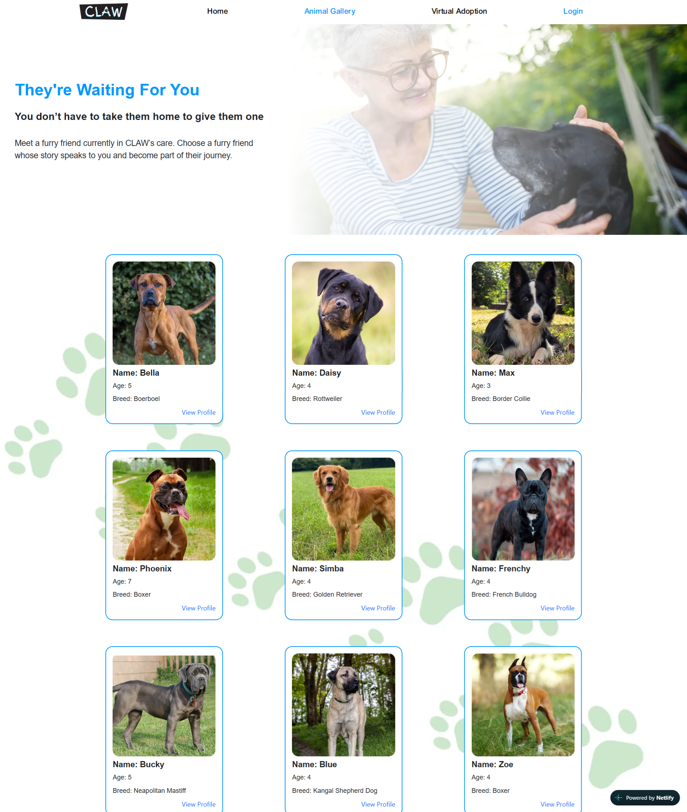
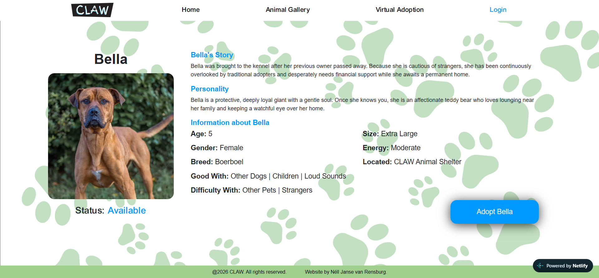
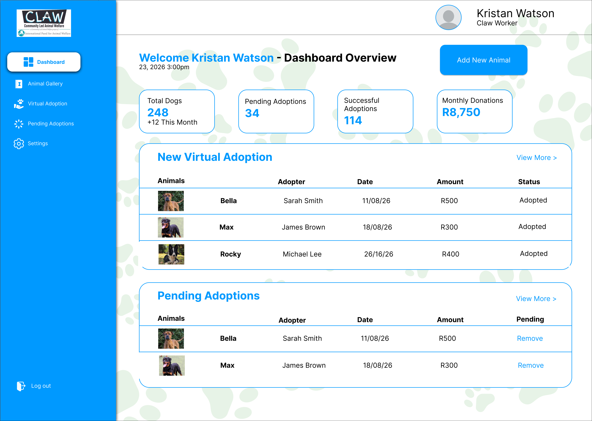
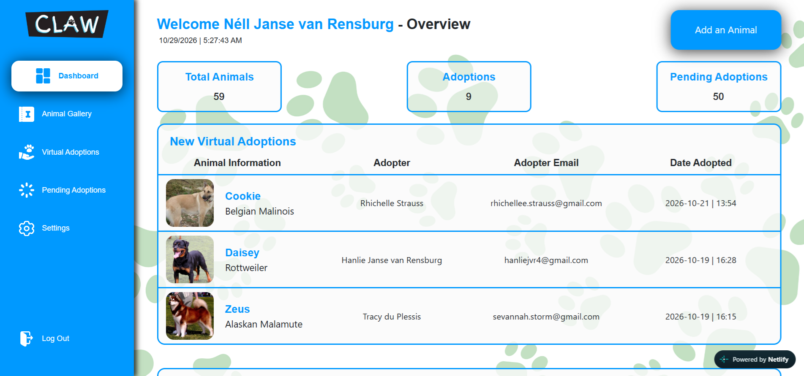

# 
CLAW Virtual Adoption Application

## This repository was used to deploy using Railway and Netlify, linked [here](https://claw-virtual-adoption.co.za).
### AWS Deployed Application [link](https://main.d27iq5vkliqz0x.amplifyapp.com).  
### AWS Repository [link](https://github.com/Nell-JvR-251061/claw-virtual-adoption-web-aws).

## Table of Contents
* [Overview](#overview)
* [Design Evolution](#design-evolution)
    * [Homepage](#homepage)
    * [Animal Gallery](#animal-gallery)
    * [Animal Profile](#animal-profile)
    * [Admin Dashboard](#admin-dashboard)
* [Features](#features)

## Overview
A web-based application platform for virtually adopting pets and making donations to support CLAW (Community Led Animal Welfare).  
DISCLAIMER: This is a partnered-based project between The Open Window Institute and selected NGOs, in which students were tasked to create digital solutions for said NGOs. This is a student-built project for educational purposes, some information and/or features might be inaccurate, missing or incomplete.

## Design Evolution
The original design of the application was created by our UX(User Experience) peers, based on their interviews with a variety NGOs, to help them with their digital problems. Upon receiving these designs, some changes were be made to improve the overall quality and functionality of the application.
### Homepage

Original

Updated

### Animal Gallery

Original

Updated

### Animal Profile

Original

Updated

### Admin Dashboard

Original

Updated

Most of the original design is still in-tact; the only true changes were some content was either cut or changes here and there to keep the project in scope. Additionally there was improvement on spacing and overall flow. I chose to forgo the donation features as I saw no point in implementing a fake feature, however looking back I believe it would have been better to incorporate it.

## Features